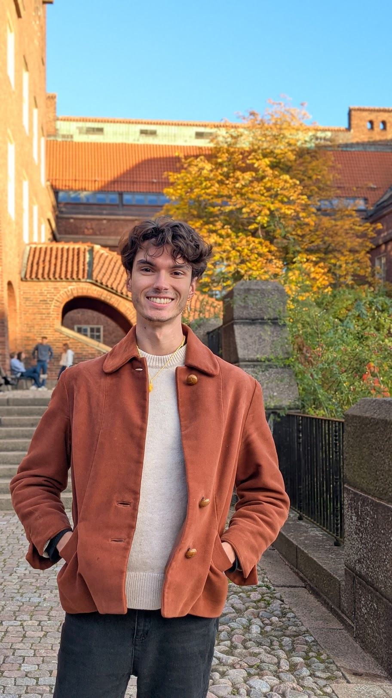

# Melvin Gode

PhD student at [KTH Royal Institute of Technology](https://www.kth.se/) in Stockholm.

## Intro
I currently just started my PhD at the [Department of Robotics, Perception and Learning](https://www.kth.se/rpl/department-of-robotics-perception-and-learning-1.779439) where I am working within [Danica Kragic](https://www.kth.se/profile/dani)'s group on the **Digitizing Smell** project!
Before that I graduated from the [MVA](https://www.master-mva.com/) in Machine Learning at ENS Paris-Saclay and previously studied Computer Science and Math at [Paris-Dauphine University](https://dauphine.psl.eu/en/training/masters-degrees/computer-science/m1-i2d).

## Publications
Be patient.

## Recommendations and Interests
Things that I found most stimulating or that had the most impact on how I view the world.

### Music
<small>Might change sporadically.</small>
- Interpol
- YARD
- Gurriers
- The 113

### Books
- The Black Swan
- Superintelligence
- Antifragile
- The Selfish Gene & The Extended Phenotype
- Human Enhancement
- What We Owe The Future

### Youtube Channels
- [Sebastian Lague](https://www.youtube.com/c/SebastianLague)
- [Fractal Philosophy](https://www.youtube.com/@FractalPhilosophy)
- [The 80,000 Hours Podcast](https://www.youtube.com/@eightythousandhours)
- [Mr Phi](https://www.youtube.com/monsieurphi) (in French)

### Video Games
- Celeste
- Satisfactory
- Superliminal
- Return of the Obra Dinn
- The Witness

### Research
- Time Series
- Graphs
- Multi-agent systems, Game Theory and emergence

## Contact
<a href="mailto:mgode@kth.se">email</a>
